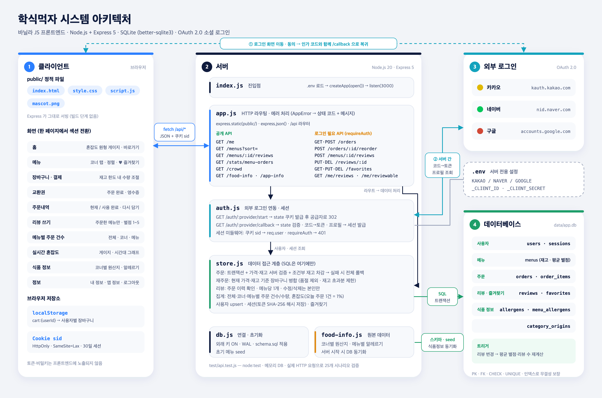

# 학식먹자

학생식당 사전 주문 서비스. 기존 정적 프로토타입(`public/`)에 SQLite + Express API 를 연결했다.



## 실행

```bash
npm install
cp .env.example .env   # 사용할 로그인 공급자의 키 입력
npm start              # http://localhost:3000
npm test               # API 통합 테스트
```

Node.js 20.12 이상. DB 파일은 처음 실행할 때 `data/app.db` 에 만들어지고, 기존 프로토타입의 메뉴가 초기 데이터로 들어간다.

## 구조

```
public/            기존 프론트엔드 (index.html, script.js, style.css)
server/
  schema.sql       테이블 · 인덱스 · 트리거
  db.js            연결(외래 키 ON), 스키마 적용, 초기 메뉴
  store.js         데이터 접근 계층 (SQL, 트랜잭션, 검증)
  auth.js          외부 로그인(OAuth 2.0) 연동, 세션
  food-info.js     메뉴별 알레르기 · 코너별 원산지 (원본 데이터, 시작 시 DB 동기화)
  app.js           HTTP 라우팅
test/api.test.js   통합 테스트
```

## 로그인

로그인 화면의 카카오톡·네이버·구글 버튼은 각 공급자의 공식 OAuth 2.0 인가 코드 방식으로 연결된다.
`.env` 에 `<PROVIDER>_CLIENT_ID` (+ `_CLIENT_SECRET`) 를 넣은 공급자만 활성화되고, 나머지 버튼은 흐리게 표시된다.
각 개발자 콘솔에 등록할 Redirect URI: `${BASE_URL}/api/auth/<kakao|naver|google>/callback`

- 키와 공급자 액세스 토큰은 서버에서만 사용하고 저장하거나 프론트엔드로 보내지 않는다.
- 로그인에 성공하면 `HttpOnly` 세션 쿠키(30일)를 발급하고, DB 에는 토큰의 SHA-256 해시만 저장한다.

## 식품 정보 (알레르기 · 원산지)

`server/food-info.js` 가 원본이다. 서버를 시작할 때마다 이 파일 내용으로 `menu_allergens`, `category_origins` 테이블을 다시 맞춘다.

- **원산지**: 코너(카테고리)별, 식당 제공 정보. 스낵·한식·일식은 같은 목록을 쓴다.
- **알레르기**: 메뉴별. 메뉴 이름으로 추정한 **초안**이며 `ALLERGENS_VERIFIED = false` 인 동안 화면에 "확인 전" 안내가 표시된다.
  식당의 실제 정보로 채운 뒤 `true` 로 바꾸고 서버를 재시작하면 된다.

## API

| 메서드 | 경로 | 인증 | 설명 |
|---|---|---|---|
| GET | `/api/me` | | 현재 사용자 (비로그인이면 `null`) |
| GET | `/api/menus?sort=` | | `default` `price_asc` `price_desc` `rating_desc` `rating_asc` |
| GET | `/api/menus/:id/reviews` | | 메뉴, 리뷰(최신순), 내 작성 가능 여부 |
| GET | `/api/stats/menu-orders` | | 전체 · 카테고리별 · 메뉴별 주문 건수와 수량 (취소 제외) |
| GET | `/api/food-info` | | 메뉴별 알레르기 · 코너별 원산지 |
| GET/POST | `/api/orders` | ✔ | 내 주문 목록 / 주문 생성 |
| POST | `/api/orders/:id/reorder` | ✔ | `{cart}` 에 과거 주문을 합친 장바구니 반환 |
| POST | `/api/menus/:id/reviews` | ✔ | 리뷰 작성 (주문 이력 필요, 메뉴당 1개) |
| PUT/DELETE | `/api/reviews/:id` | ✔ | 내 리뷰 수정 / 삭제 |
| GET | `/api/me/reviews` | ✔ | 내가 쓴 리뷰 |
| GET | `/api/me/reviewable` | ✔ | 리뷰 쓰기 화면: 내가 주문했던 메뉴와 작성 여부 |
| GET | `/api/favorites` | ✔ | 즐겨찾기 |
| PUT/DELETE | `/api/favorites/:menuId` | ✔ | 즐겨찾기 추가 / 해제 |
